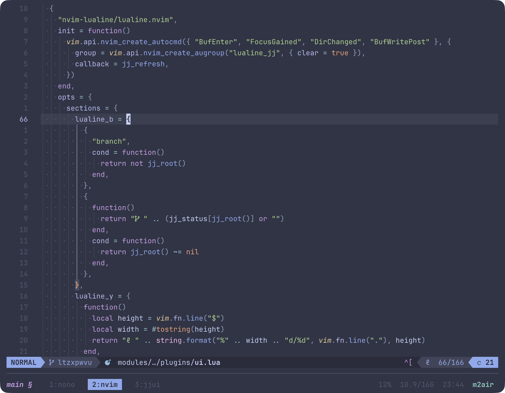

# dotfiles

[](https://github.com/xkef/dotfiles/actions/workflows/ci.yml)
[](https://scorecard.dev/viewer/?uri=github.com/xkef/dotfiles)



macOS and Arch Linux dotfiles, deployed with
[Dotter](https://github.com/SuperCuber/dotter).

## Install

```bash
git clone https://github.com/xkef/dotfiles ~/dotfiles
~/dotfiles/setup/deploy
```

Deploy installs packages with Homebrew or pacman and links the configs into
`$HOME`. `dots apply` deploys again after a change.

The configs live in packages under `modules/`. A machine gets `core`, `desktop`,
and `agents`, and a VM gets `core` and `agents`. The extras `wezterm`, `helix`,
`zed`, and `kickstart` install only when selected. The `packages` list in
`~/.local/state/dotter/local.toml` sets the selection:

```toml
packages = ["core", "desktop", "agents", "wezterm"]
```

## Included tools

| Tool                                                                               | What it does                                               |
| ---------------------------------------------------------------------------------- | ---------------------------------------------------------- |
| [Fish](https://fishshell.com)                                                      | Shell with tv pickers and practical defaults               |
| [Starship](https://starship.rs)                                                    | Minimal, cross-shell prompt                                |
| [Neovim](https://neovim.io) + [LazyVim](https://www.lazyvim.org)                   | Editor with the LazyVim distro                             |
| [Ghostty](https://ghostty.org)                                                     | Terminal that runs tmux, themed with the rest              |
| [tmux](https://github.com/tmux/tmux) + [sesh](https://github.com/joshmedeski/sesh) | Multiplexer and sessions, with an agent picker             |
| [WezTerm](https://wezterm.org)                                                     | Extra: terminal and multiplexer, on the tmux keys          |
| `theme`                                                                            | Color themes for terminal, Neovim, Helix, delta, and pi    |
| [television](https://github.com/alexpasmantier/television)                         | Fuzzy finder in the shell and the pickers                  |
| [atuin](https://atuin.sh)                                                          | Searchable shell history with sync                         |
| [Claude Code](https://claude.com/claude-code), [pi](https://pi.dev)                | AI coding agents, always launched in a nono sandbox        |
| [Jujutsu](https://github.com/jj-vcs/jj)                                            | Git-compatible version control, `jj`, with a simpler model |
| [Lima](https://lima-vm.io)                                                         | Linux development VM with the host's dotfiles setup        |
| [Vale](https://vale.sh)                                                            | Prose linter for markdown, Google style plus AI-tell rules |
| eza, bat, fd, ripgrep, zoxide, yazi, mise                                          | Command-line replacements and workflow tools               |

## Keys

Neovim uses `Space` as leader, and WezTerm and tmux use `Ctrl-Space`. `leader ?`
in WezTerm and tmux lists the bindings, and `Space` in Neovim opens the
which-key menu.

`dots theme` switches Ghostty, WezTerm, Neovim, Helix, delta, and pi together.
It offers Catppuccin, Tokyo Night, Rosé Pine, and Kanagawa, each a palette file
in `modules/core/.config/theme/palettes`.

## Agent sandbox

`claude` and `pi` start in a [nono](https://nono.sh) sandbox. nono's credential
proxy adds the Claude and GitHub tokens to outgoing requests, so the sandbox
holds only placeholders. `agents vm` runs Claude Code in a
[Lima](https://lima-vm.io) VM on a copy of the repository instead, behind the
same proxy.

## Private files

Private files, such as the git and jj identity, live in an
[age](https://age-encryption.org)-encrypted archive, `private/home.tar.age`.
Encrypt an edited or new file back with:

```sh
mise run encrypt ~/.config/git/identity
```

## Credits

Inspired by [wincent/wincent](https://github.com/wincent/wincent), with
borrowings from [omerxx/dotfiles](https://github.com/omerxx/dotfiles),
[ThePrimeagen](https://github.com/ThePrimeagen/.dotfiles), and
[LazyVim](https://github.com/LazyVim/LazyVim).
