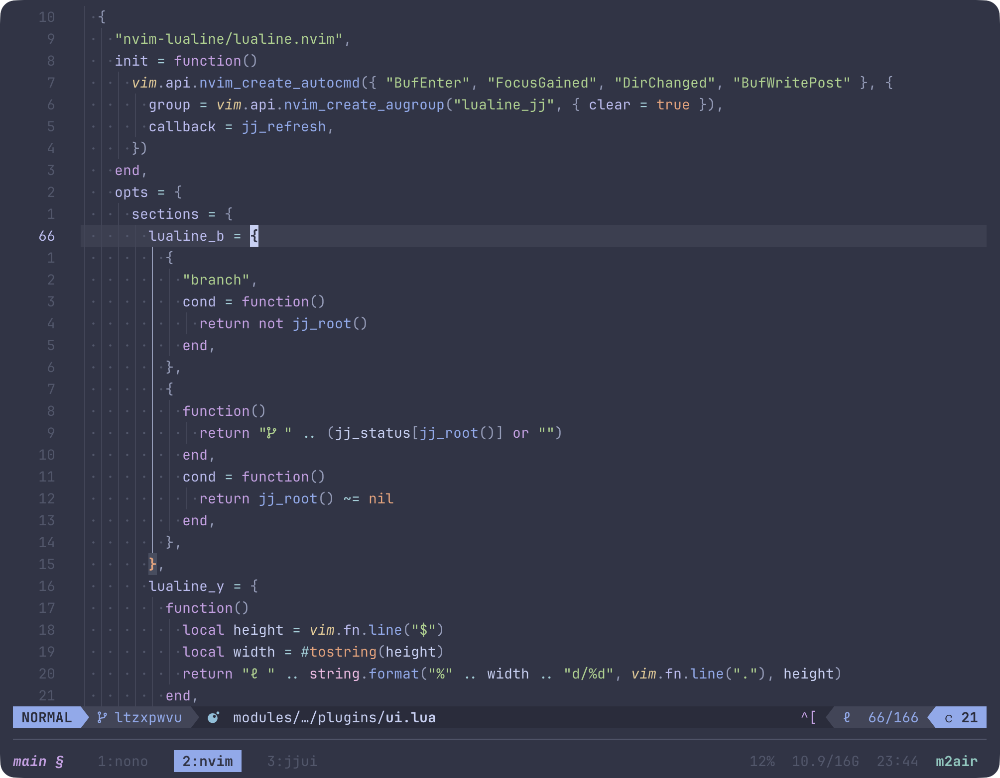

# dotfiles

[](https://github.com/xkef/dotfiles/actions/workflows/ci.yml)
[](https://scorecard.dev/viewer/?uri=github.com/xkef/dotfiles)



macOS and Arch Linux dotfiles, applied by one fish script, `setup/apply`.

## Install

```bash
git clone https://github.com/xkef/dotfiles ~/dotfiles
~/dotfiles/setup/bootstrap
```

Bootstrap installs fish and runs `setup/apply`, which prints its plan and asks
before it applies. `dots apply` reruns it and repairs drift. `dots apply --help`
lists the options, such as `--plan`, `--modules core,agents`, and `--no-admin`
for a user without administrator rights. The state, such as the selected
modules, lives in `~/.local/state/dotfiles`, which the repo links as `state/`.

## Modules

A new machine gets every module that fits it. Every selection needs `core`.

| Module      | What it holds                                                         |
| ----------- | --------------------------------------------------------------------- |
| `core`      | fish, Starship, Neovim with LazyVim, tmux, jj, and command-line tools |
| `desktop`   | Ghostty, GUI apps, and the 1Password SSH agent                        |
| `agents`    | Claude Code and pi in a [nono](https://nono.sh) sandbox               |
| `agentvm`   | A sandbox VM for agents with no network device, on macOS              |
| `wezterm`   | WezTerm, on the tmux keys                                             |
| `rex`       | Keys for the Rex beta app, on the tmux keys                           |
| `helix`     | Helix with its format tools and language servers                      |
| `zed`       | Zed                                                                   |
| `kickstart` | kickstart.nvim, a minimal Neovim config, run as `knvim`               |
| `private`   | The [private files](#private-files), opt-in. Needs `desktop`          |

## Keys

Neovim uses `Space` as leader, and WezTerm and tmux use `Ctrl-Space`. `leader ?`
lists the bindings. `dots theme` switches the colors of every themed tool at
once.

## Agent sandbox

nono's credential proxy adds the Claude and GitHub tokens to the agents'
requests. Store the tokens once on each machine. The GitHub entry takes its name
from `git config --global github.user`, or else from gh's user:

```sh
claude setup-token  # then store its output:
security add-generic-password -s nono -a claude_code_oauth_token -w
security add-generic-password -s nono -a github-<gh user> -w
security add-generic-password -s nono -a openrouter_api_key -w  # pi
# Linux: secret-tool store --label=nono service nono account github-<gh user>
```

## Private files

Private files, such as the git identity, live in `private/home.tar.age`, an
[age](https://age-encryption.org) archive whose key sits in 1Password.
`mise run encrypt <file>` adds one and signs the archive. The apply refuses an
archive without a signature from a key in `private/allowed_signers`.

## Credits

Inspired by [wincent/wincent](https://github.com/wincent/wincent), with
borrowings from [omerxx/dotfiles](https://github.com/omerxx/dotfiles),
[ThePrimeagen](https://github.com/ThePrimeagen/.dotfiles), and
[LazyVim](https://github.com/LazyVim/LazyVim).
